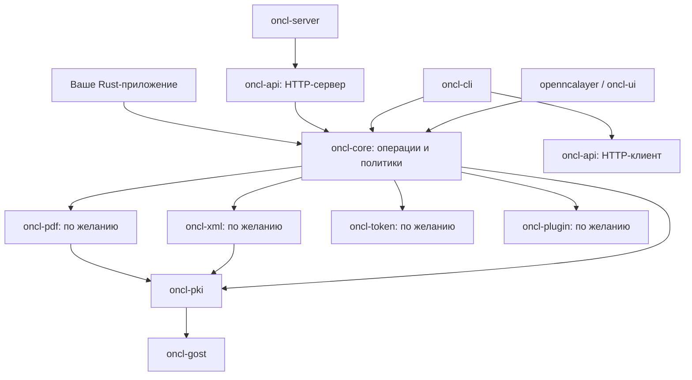

# OpenNCALayer как платформа: SDK, desktop, CLI и HTTP-сервис

Документ для тех, кто хочет понять, как проект устроен «вширь»: что, кроме десктопной программы, он умеет, какие у этого границы и по каким правилам это делается. Здесь описаны цели и договорённости. Что уже работает, смотрите в [README](../../README.md) и в [руководствах пользователя](../user/install.md).

Связанные документы: [общий план](roadmap.md), [плагины](plugins.md), [токены](tokens.md).

## 1. Идея

Раньше вся подпись жила внутри десктопной программы. Теперь криптография вынесена в общую библиотеку на Rust, а программа — только один из способов ей пользоваться.

Способов четыре:

| Способ | Для кого |
|---|---|
| **Десктопная программа** | Обычный человек. Работает с сайтами по протоколу NCALayer и открывает окна для ручной подписи. |
| **Rust-библиотека (SDK)** | Разработчик, который встраивает подпись в своё приложение. |
| **Командная строка `oncl`** | Скрипты и администраторы. Работает локально или через HTTP-сервис. |
| **HTTP-сервис `oncl-server`** | Серверные интеграции. По возможностям заменяет NCANode, но с собственным API. |

Главное, о чём договорились:

- **Одна реализация на всех.** Криптография не копируется между десктопом, CLI и сервисом.
- **Не копируем NCANode один в один.** У нас свой API. Возможностей столько же, но запросы и ответы NCANode не повторяются.
- **Большие файлы.** XML и PDF обрабатываются тоже, до 1 ГиБ на файл. Проверочная операция укладывается в 1 ГиБ оперативной памяти на 64-битной системе. Временные файлы допускаются. Файл больше 1 ГиБ отклоняется ошибкой «превышен лимит входа». Предел NCANode (около 30 МиБ) — особенность самого NCANode, нашего обещания он не определяет.
- **Права везде выдаются явно.** В десктопе человек подтверждает действие в окне. В сервисе права заранее выдаёт администратор. Новый HTTP API по умолчанию выключен.
- **Документы не хранятся.** Сервис ведёт только журнал метаданных (кто, какая операция, каким ключом, чем кончилось). Если журнал недоступен, закрытый ключ не применяется.
- **Один репозиторий и общая версия** SDK и приложений.

Не входит в эту работу: темы оформления, профили и корпоративная настройка, универсальные формы настроек плагинов, шифрование по паролю, универсальная интеграция PKCS#11 и HSM.

## 2. Что не меняется для существующих сайтов

Сайты продолжают работать с программой так же: протокол NCALayer, WSS, установленные модули, задокументированные отличия от оригинала. Новый HTTP API этот интерфейс не заменяет. Его вход по токену на WSS не переносится, а новые лимиты больших файлов не расширяют старые лимиты протокола.

Правила проверки сертификатов теперь заданы явной политикой. SDK, CLI, HTTP и ручные инструменты десктопа работают по строгой политике. Слой совместимости с NCALayer сохраняет свою прежнюю, описанную в документации семантику. Строгий режим не откатывается к ней незаметно, а отчёт никогда не называет непроведённую проверку успешной.

## 3. Из чего состоит проект

Имена крейтов — это структура репозитория. Свободны ли такие имена в crates.io, проверим перед публикацией.

| Крейт | Что делает |
|---|---|
| `oncl-core` | Публичный SDK: подпись, проверка, шифрование, лимиты ресурсов, структурированные отчёты. Без окон, установщика, автозапуска и самообновления. |
| `oncl-pki` | Контейнеры ключей, сертификаты, CMS, проверка цепочки, OCSP/CRL, метки времени. |
| `oncl-xml` | XMLDSig, XAdES, WS-Security, разбор больших XML. |
| `oncl-pdf` | Подписи PDF (PAdES), их проверка и достройка. Тяжёлая зависимость, не нужна тем, кому нужен только CMS. |
| `oncl-gost` | ГОСТ-примитивы. Ничего не знает ни о запросах, ни об окнах. |
| `oncl-token` | Драйверы аппаратных носителей. |
| `oncl-plugin`, `oncl-pdk` | Запуск WASM-плагинов и набор для их написания. Работают без графики. |
| `oncl-flows` | Сценарии десктопа: выбор ключа, подтверждения, очередь окон. Своей копии криптографии не содержит. |
| `oncl-api` | HTTP-контракт, описание OpenAPI, ошибки, потоковые ответы. |
| `oncl-cli` | Команда `oncl`. |
| `oncl-server` | Сборка HTTP-сервиса: настройки, права клиентов, ключи, журнал, лимиты. |
| `openncalayer`, `oncl-ui`, `oncl-desktop` | Десктоп: окна, трей, обновления, интерфейс NCALayer. |

Принципы: один движок операций (а не тонкая «обёртка-SDK» над вторым таким же), никаких крейтов «на каждый метод» и пустых прослоек. При переносе кода обновляются все пользователи и документация, старые модули-алиасы не оставляются.

### Как должен вести себя SDK

- Принимает явно: откуда данные, куда писать результат, какой ключ или получатели, какой профиль операции, чему доверять и какие лимиты ресурсов.
- Возвращает результат и структурированный отчёт либо типизированную ошибку.
- Умеет читать последовательный поток неизвестной длины и файл с произвольным доступом. Временный файл для формата создаётся осознанно, а не «тихо» вместо буфера в памяти.
- Приложение-хозяин даёт сеть для проверок, источники ключей, временное хранилище, отмену, прогресс и настройки доверия. SDK не читает настройки десктопа.
- Не запускает демон, окно, обновления, экспорт телеметрии, глобальный logger или свой async-рантайм.
- Чистая криптографическая проверка работает без сети. Полная проверка доверия отдельно учитывает данные из сети.
- Токены, PDF, XML, плагины и телеметрия не обязательны для минимальной сборки. Минимальную сборку проверяют отдельно.
- Ошибки различают: неверный ввод, неподдерживаемую операцию, нехватку прав, нужное взаимодействие, недоступный ключ или носитель, лимиты, отмену, сеть и внутренний сбой. Машинный код ошибки — не человеческий текст.
- Если запись результата оборвалась, в выходном потоке может остаться неполное начало. Успех определяется итоговым результатом, а не наличием байтов. Файл публикуется только после успеха.

## 4. Что умеет криптография

### 4.1 Возможности уровня NCANode

Мерило полноты — [OpenAPI NCANode на зафиксированном коммите](https://github.com/ncanode-kz/NCANode/blob/0adab29a7d30c181d70e8cc6b4f243122f50c3b8/openapi.yml). Названия его маршрутов ниже означают только сравниваемые возможности, а не наши адреса.

| Семейство | Что нужно уметь |
|---|---|
| CMS / CAdES | Прикреплённая и отсоединённая подпись; несколько подписантов; добавление подписи; извлечение содержимого; проверка; уровни B, T, LT, LTA; достройка уже существующей подписи до LT/LTA. |
| XMLDSig / XAdES | Создание и проверка; несколько подписей; уровни B, T, LT, LTA. Каноникализация и ссылки — часть корректности, а не косметика. |
| WS-Security | Подпись и проверка SOAP, включая проверку того, какой узел подписан. |
| PDF / PAdES | Встроенная подпись и проверка; B, T, LT, LTA; достройка. Подпись PDF-байтов внешним CMS не считается PAdES. |
| JWS | Создание, добавление подписанта, проверка; сериализации и отсоединённые варианты фиксируются в таблице профилей. |
| JWT | Создание, разбор и проверка. Разбор не называется проверкой. Алгоритм не берётся из недоверенного заголовка. |
| X.509 и «сырая» подпись | Сведения о сертификатах; подпись и проверка произвольных данных с отдельной подписью. Собственного удостоверяющего центра у нас нет. |
| PKCS#12 | Сведения о контейнере и сертификатах, список псевдонимов. Закрытые ключи клиенту не отдаются. |

Для каждого семейства нужна таблица профилей и алгоритмов, положительные и отрицательные примеры и проверка независимой реализацией. Если проверять подпись только нашим же проверяющим кодом, это ничего не доказывает. Любое ограничение описывается явно. Нельзя объявить «полную замену», если не хватает целого семейства.

### 4.2 Дополнительно

- Хеши, получение и проверка меток времени (RFC 3161), просмотр и проверка сертификата, цепочки и отзыва.
- Шифрование для одного или нескольких получателей по сертификатам и расшифрование закрытым ключом. Профили CMS; обязательны RSA и применимые казахстанские ГОСТ-профили, не только RSA.
- Контролируемый программный вызов операций плагинов.
- Пакетная обработка с отдельным результатом на каждый элемент.

Фокус — ГОСТ-2004, ГОСТ-2015/512 и RSA для казахстанской ЭЦП, а также явно настроенные удостоверяющие центры с поддерживаемыми алгоритмами. Все международные алгоритмы мы не обещаем. То, что мы умеем проверять RSA-SHA1, не значит, что мы разрешаем создавать новые подписи RSA-SHA1.

Для каждой операции проверяются алгоритм, назначение сертификата и возможности ключа или носителя. Сертификат для подписи не годится для шифрования только потому, что у него тот же владелец. Неподдерживаемый профиль молча не подменяется другим.

ГОСТ-шифрование требует проверенного сочетания идентификаторов, параметров, согласования и обёртки ключа и шифрования содержимого. [RFC 4490](https://www.rfc-editor.org/rfc/rfc4490) и [RFC 7836](https://www.rfc-editor.org/rfc/rfc7836) описывают старые российские соглашения. Сами по себе они не доказывают совместимость с казахстанским профилем. Свой формат контейнера выдумывать нельзя, как и просто подставлять российские идентификаторы. Нужны независимые тестовые векторы.

Шифроконтейнер описывается честно: простое расшифрование не доказывает автора. Если профиль с проверкой подлинности, результат не отдаётся до проверки. Если профиль без неё, он не выдаётся за проверенный.

Создание, экспорт и импорт закрытых ключей не добавляются в CLI и API. Прежние функции NCALayer (запрос на сертификат, импорт) остаются там, где были.

### 4.3 Проверка и доверие

У полной проверки три итога: `VALID`, `INVALID`, `INDETERMINATE` (недостаточно данных). Отчёт раздельно показывает целостность, сертификат и цепочку, срок, отзыв, метки времени, применённую политику и время, на которое проверяли. Для нескольких подписантов — по каждому.

- Нет сети или свежих данных об отзыве — это не «зелёный» результат. Можно явно попросить проверку без сети: она перечислит, что не проверялось, и не меняет смысл `VALID`.
- Проверка перед подписью не пропускается из-за временной недоступности сети.
- Время подписи (`signingTime`), присланное в документе, не считается доказанным временем. LT и LTA проверяются по временным доказательствам и допустимым алгоритмам.
- Сертификаты, присланные клиентом, помогают построить путь, но не становятся доверенными. Дополнительные центры задаёт администратор или приложение-хозяин. HTTP-клиент не может расширить доверие запросом.
- Небезопасные конструкции XML, внешние сущности и неоднозначные ссылки не разрешаются ради совместимости.

## 5. Большие документы и ресурсы

**Контрольный профиль:** файл до 1 ГиБ (включая содержательные XML и PDF), одна операция укладывается в 1 ГиБ RAM в отдельном 64-битном процессе. Меряется реальная память процесса. В отчёте фиксируются система, сборка, файл, профиль, пик памяти, временный диск и время. Скорость мы не обещаем.

Выход может быть больше входа из-за упаковки и подписи, он тоже учитывается в квоте. Проверяющий и расшифровщик должны принимать результат обработки допустимого документа, даже если из-за накладных байтов он чуть больше 1 ГиБ. Эти надбавки ограничены отдельными бюджетами. Обещания для других платформ и для враждебных документов такого размера нет.

Как это достигается:

- SDK принимает потоки и файлы. CLI — файлы и stdin/stdout. HTTP — бинарные потоки и multipart. Base64-строка на весь документ не требуется.
- Потоковые пути (CMS, хеши, шифрование) не создают полный буфер документа. Если формату нужна известная длина или второй проход, можно использовать временный файл.
- XML: потоковый разбор и каноникализация, где возможно; индексы в файле и повторные проходы для ссылок. Целое дерево документа в памяти не решение. Должны работать не только искусственные файлы с одним гигантским текстовым узлом.
- PDF: доступ к таблицам и объектам через файл, без загрузки всей модели в RAM. Приёмка включает потоки объектов, ревизии, существующие подписи и большое число объектов и страниц, а не только файл, раздутый до нужного размера.
- Сохраняются лимиты глубины, сложности преобразований, ссылок, распаковки и вычислений. Они подобраны так, чтобы принимать контрольные документы, а не оставаться малыми при увеличенном пределе байтов.
- Размеры и смещения — 64-битная арифметика с проверкой. Отображение файла в память не считается соблюдением предела RAM без измерения.
- Лимиты входа, выхода, временного диска, памяти, времени и числа операций задаются явно. При неизвестном `Content-Length` поток обрывается на лимите, а не после полного чтения.
- Общий бюджет сервера ограничивает параллельность. При нехватке — отказ или ограниченное ожидание, а не бесконечная очередь. Окна десктопа не блокируют сервис. Конкретный токен может требовать, чтобы его команды шли по очереди.
- Прогресс различает известную и неизвестную общую длину. Отмена проверяется между безопасными шагами. Уже применённый ключ не считается отменённым.

Временные документы лежат только в отдельном каталоге с правами владельца, с квотами и сроком жизни. Очистка удаляет только свои файлы и только известные остатки. Ключи и пароли туда не попадают. Права доступа — не шифрование диска, а гарантированное стирание на SSD мы не обещаем.

Результат пишется во временный файл и публикуется после успеха. Исходник не перезаписывается незаметно. Для больших HTTP-ответов и stdout контракт явно говорит, что считать финальным статусом. Криптографическая подпись не откатывается.

Плагины со старыми лимитами (строки, Base64) сохраняют их, при превышении будет конкретная ошибка. HTTP-обёртка не делает их потоковыми.

## 6. Десктоп и настройки

### 6.1 Как должны выглядеть окна

Договорено о структуре и трёх экранах: ручная подпись, подтверждение запроса сайта, отчёт проверки. Это направление, а не окончательные тексты.

- **Единый центр** с боковым меню: обзор, подпись, проверка, шифрование и расшифрование, сертификаты, дополнительные инструменты (хеши, метки времени, разрешённые плагины), плагины, настройки. Открывается по запросу.
- **Запрос сайта** — отдельное компактное окно. Видно, какой сайт просит, какая операция и что существенно. Фоновая работа с сайтами не открывает главное окно.
- **Операция идёт по шагам в одном окне:** источник ключа → разблокировка → сертификат и подтверждение → результат. Можно вернуться назад, не выбирая файл заново. Секретные значения после операции не сохраняются.
- В ручном сценарии сначала выбирают файлы и формат, потом ключ. До выполнения видны состав пакета, профиль, куда пойдёт результат и что случится с исходниками.
- **Разблокировка — не согласие подписать.** Итоговая кнопка называет действие: «Подписать», «Войти», «Передать сведения», а не общее «ОК».
- Подтверждается конкретный набор документов. Изменение состава или подмена содержимого после подтверждения требует нового согласия. Для этого обработка идёт по своему снимку выбранных данных.
- До действия видны владелец и назначение сертификата, организация, срок и состояние проверок. Имена файлов от сайта помечены как недоверенные.
- Отчёт проверки разделяет общий вывод и причины по проверкам и подписантам. Предупреждение «не хватает данных» визуально отличается и от успеха, и от доказанной недействительности.
- Ошибка показывается рядом с проблемным местом. Неподходящий сертификат не пропадает молча, причина понятна.

Интерфейс остаётся на Slint. HTML использовался только для согласования макетов. Системный шрифт, читаемый размер, одна основная кнопка, смысловые цвета. Переписывания на WebView или Electron, декоративных эффектов и загрузчика тем нет.

### 6.2 Что запоминается

- Остаются язык, автозапуск, прокси, обновления и включение токенов. Добавляются масштаб интерфейса, работа с клавиатуры, видимый фокус и корректный DPI. Управление не зависит только от мыши, цвета, перетаскивания или наведения.
- **Недавние пути и избранные сертификаты** хранятся без закрытых ключей и паролей и очищаются кнопкой. При использовании путь и сертификат проверяются заново: запись не доказывает, что файл не менялся.
- **Пароли и разблокированные ключи** между операциями не кешируются и на диск не пишутся. Одно подтверждённое действие — одна операция. Разрешением подписывать следующие запросы сайта оно не является.
- Не добавляются: настройка трея и уведомлений, горячие клавиши, напоминания об истечении сертификатов. Существующее поведение остаётся. Журнал действий выключен по умолчанию и не превращается в архив документов.

## 7. CLI и HTTP API

### 7.1 Командная строка `oncl`

Работает без десктопа и без сервера. Обращение к HTTP-сервису — отдельный осознанный режим.

- Команды соответствуют возможностям SDK. Прежняя команда `openncalayer cms-verify` перенесена в `oncl`, без вечного алиаса. Команды запуска, установки и TLS остаются в десктопе.
- Вход: файлы и stdin. Выход: явный файл или stdout. В режиме обращения к сервису путь входа — путь на вашем компьютере: клиент отправляет байты, а не просит сервер открыть путь.
- Вывод для человека и машинный JSON. Прогресс и диагностика не мешаются с машинным stdout. Двоичный stdout и JSON-отчёт не смешиваются.
- Секрет вводится без отображения. Для автоматизации — защищённый файл, дескриптор или внешний источник. Пароль и токен не передаются в аргументах командной строки и не попадают в текст ошибок.
- У пакета свои результаты по элементам и итоговый статус. Успешные элементы не откатываются. По умолчанию независимые элементы продолжаются после ошибки; отмена или потеря обязательного ресурса останавливает всё.
- Различимы машинно: неверная подпись, неопределённая проверка, ошибка выполнения, частичный результат, отмена. Таблица кодов выхода — часть версионируемого контракта. Подробности: [`docs/user/cli.md`](../user/cli.md).

### 7.2 HTTP API

Свой контракт OpenAPI. Небольшие управляющие сообщения — JSON, большие данные — бинарные потоки и multipart. Маршрутов NCANode нет. Подробности: [`docs/user/http-api.md`](../user/http-api.md).

- Версия в пути (`/v1`). Типизированные JSON-объекты и единая ошибка со стабильным `code` и идентификатором операции. Код HTTP описывает транспорт, доступ и исполнение. Завершённый отчёт с итогом `INVALID` не превращается в безымянную внутреннюю ошибку.
- **API выключен по умолчанию.** Установка, запуск десктопа и создание SDK не открывают ни порт, ни loopback. Включает администратор.
- При включении адрес по умолчанию — loopback. Внутреннюю сеть разрешают явно. Выставлять сервис прямо в интернет не предполагается.
- **Доступ по отзываемым токенам** с правами на операции, идентификаторы ключей и операции плагинов. Одного общего пароля и анонимной подписи нет. Взаимная аутентификация TLS (mTLS) не выбрана обязательной.
- Для сети нужен TLS в самом сервисе или явно настроенный доверенный прокси. Заголовкам `Forwarded` и `X-Forwarded-*` без настройки доверять нельзя. Loopback сам по себе не проверка личности.
- Через обычный запрос подписи клиент не получает: пути на сервере, загрузку документов по URL, управление доверием, чтение ключей и административные действия. Исходящие обращения плагинов и PKI — отдельные ограниченные права.
- Права проверяются до применения ключа и до вызова плагина. Реально выполняемая операция не может отличаться от разрешённой (например, другой метод внутри вложенных данных).
- Запрос живёт, пока открыто соединение. Нет номеров заданий для последующего опроса, постоянного планировщика, базы заданий и восстановления после перезапуска, нет обещания «ровно один раз».
- Для прогресса и больших пакетных результатов ответ идёт частями multipart: события, данные, явный итог по элементу и по вызову. Нет итога — значит исход неизвестен, а не успешен. Заголовок HTTP сам по себе успех не подтверждает.
- Обрыв соединения останавливает дальнейшую работу и чистит временные данные. Уже созданная подпись не отменяется. Операция, которая могла выполниться, автоматически не повторяется.

## 8. Ключи, плагины и секреты

### 8.1 Кто даёт полномочия

В десктопе человек подтверждает действие. В сервисе права заранее выдаёт администратор: окон нет, и автоматического «Да» вместо человека тоже нет. Запуск команды CLI — явное намерение администратора в пределах переданных параметров, окно подтверждения для CI не требуется.

Сервис не наследует ключи, согласия, недавние файлы, настройки и каталоги десктопа. Если SDK встроен в ваше приложение, ключи и права SDK даёте вы. Библиотека не защищает от вашего собственного привилегированного кода.

### 8.2 Откуда берутся ключи

- Файлы PKCS#12 и JKS, а также наши аппаратные токены. JKS получает только чтение.
- Главный сценарий для сервиса: администратор подключает ключ, клиент указывает его разрешённый непрозрачный идентификатор.
- По явной настройке контейнер и пароль можно передать в запросе. У секретных полей маленькие отдельные лимиты, чтобы большой поток не превратился в загрузку огромных контейнеров.
- Пароли подключённых ключей приходят снаружи: файлы с правами владельца, секреты контейнера, защищённый канал при запуске. В обычном конфиге только ссылки. Собственного менеджера секретов нет.
- Разблокированный ключ может жить в памяти работающего сервиса. После перезапуска пароль нужно подать заново. Токен API не даёт получить контейнер или пароль обратно.
- Ключи не покидают аппаратный носитель. Нельзя обещать расшифрование носителем, умеющим только подписывать: возможности проверяются явно.
- Драйверы токенов остаются экспериментальными, и это не скрывается. Проверка на эмуляторе не выдаётся за проверку на реальном устройстве.

### 8.3 Плагины в сервисе и CLI

Установленный плагин сам по себе через HTTP и CLI недоступен. Разрешаются конкретные плагины и операции. Права на ключи, файлы и сеть ограничиваются вызовом.

Вызов из сервиса — не посещение доверенного сайта. Origin не берётся из произвольного поля запроса. Если нужен шаг с человеком, возвращается ошибка `interaction_required`, а не выдуманный ответ пользователя. Операции, которым нужна браузерная сессия, не объявляются «безголовыми». Подробная модель разрешений — в [документе про ручное окно](manual-plugins.md).

Остаются `settings_get` и `settings_put`, проверка прав и ограничения пакетов. Нового конструктора экранов настроек и произвольного кода интерфейса у плагинов нет. Без явного выбора плагины не тянут в минимальный SDK десктоп, каталог и автообновление.

## 9. Данные, журнал и телеметрия

### 9.1 Что хранится

Постоянного архива документов, запросов, контейнеров ключей, паролей и результатов нет. Результат возвращается клиенту или записывается в явно выбранное место. Временные данные подчиняются правилам раздела 5.

Сервис ведёт локальный журнал метаданных (ротация, срок хранения и квота настраиваются): кто вызвал, какая операция, какой ключ, когда и чем кончилось. Содержимое и имена документов, секреты и сырые запросы и ответы в журнал не пишутся. Связь сертификата с человеком наружу в телеметрию не уходит.

**Без записи в журнал ключ не применяется.** Если журнал недоступен, подпись, расшифрование и другое применение закрытого ключа не начинаются. Телеметрия записью журнала не считается.

Записываются начало и итог с общим идентификатором операции (для пакета ещё и элементы). Если журнал отказал уже после применения ключа, действие нельзя объявить несостоявшимся. Наружу идёт честный «неопределённый» или ошибочный итог, а следующие применения ключей блокируются до восстановления журнала. Потеря ответа не значит, что ключ не применялся. Неизменяемость журнала и неотказуемость мы не заявляем.

### 9.2 OTLP-телеметрия

Метрики и трассировки по OTLP **выключены по умолчанию**. Сборщик и параметры задаёт администратор. Логи через OTLP не выбраны.

Можно отправлять: семейство операции и формата, класс результата, длительность, размеры, классы сетевых сбоев PKI, загрузку ресурсов. Нельзя: документы, пароли, токены API, ключи, ИИН и БИН, полные пути, сырые заголовки и тела, необработанные тексты ошибок. Метки метрик не должны содержать идентификаторы запросов, ключей и клиентов.

Выборка трассировок допустима и не влияет на полноту журнала. Недоступный сборщик не блокирует операции: очередь ограничена, сбой доставки виден и не съедает память. SDK не ставит глобальный обработчик телеметрии, это решает хозяин. Десктоп из-за серверной функции ничего отправлять не начинает.

## 10. Поставка и совместимость

- Десктоп остаётся самостоятельным дистрибутивом. CLI и сервис собираются отдельно и ставятся без окон и графической системы.
- Сервис запускается как отдельный процесс, служба или контейнер. Контейнеру явно передают настройки, секреты и временную папку. Домашний каталог пользователя целиком в него не монтируется. Обновляет сервис администратор, самообновление десктопа туда не переносится.
- Все платформы десктопа остаются, включая Windows 7 x86 и x64. Контроль 1 ГиБ / 1 ГиБ проводится на 64-битной системе. Новые зависимости не могут тихо убрать старую платформу.
- У Rust SDK есть документированный интерфейс, примеры, описанные ошибки и правила semver. До версии 1.0 несовместимые изменения требуют новой версии и указаний по переходу. Не все внутренние модули — стабильный публичный контракт.
- SDK и нужные ему зависимости готовятся к публикации в crates.io (проверка лицензий, состава пакетов, воспроизводимость сборки). Пока публикации нет, примеры используют git или локальный путь.
- Сама загрузка в crates.io и публикация браузерных расширений делаются только по отдельной команде владельца.
- Это не смена названия, не разнос по репозиториям и не повод переписывать механизм обновлений.

### 10.1 Установка через WinGet

Цель: чтобы десктоп ставился командой `winget install --id arynyklas.OpenNCALayer --exact`. Пока пакета в общем каталоге нет, это цель, а не готовая возможность.

- В основной пакет идут только стабильные версии. Первая заявка в `microsoft/winget-pkgs` отправляется отдельной командой после проверок.
- Используются HTTPS-ссылки на файлы релиза для Windows x64 и x86, их SHA-256 и установка на пользователя. WinGet требует Windows 10 1809 и новее. Windows 7 через WinGet не заявляется, для неё остаются обычные установщики.
- Имя, издатель и версия берутся из реальной регистрации установленной программы. Штатное подписанное самообновление остаётся включённым по настройке пользователя. Явное обновление через WinGet тоже возможно, и самообновлённая копия распознаётся без цикла «понижение — повышение».
- Установщик Velopack при переустановке принудительно останавливает программу. Поэтому вход установки и обновления из WinGet сначала должен получить у программы разрешение на обслуживание: дождаться активных операций, запретить новые на время замены и вернуть явную ошибку, если безопасно ждать нельзя. Принудительно завершать подпись нельзя. Окна, доверие к сертификатам и согласия на криптооперации автоматически не подтверждаются.
- Нужны проверки установки, обновления, переустановки и удаления в чистой Windows. Проверка YAML и `install --manifest` не доказывают, что пакет доступен в каталоге.

Основания: [манифесты](https://learn.microsoft.com/en-us/windows/package-manager/package/manifest), [подача в репозиторий](https://learn.microsoft.com/en-us/windows/package-manager/package/repository), [поддерживаемые версии Windows](https://learn.microsoft.com/en-us/windows/package-manager/winget/).

## 11. Как будем принимать результат

Список ниже — проверки, которые нужно пройти. Он не утверждает, что они уже пройдены.

| Область | Что должно быть видно |
|---|---|
| Встраивание | Отдельное Rust-приложение подписывает и проверяет через SDK без демона, окон и порта. В его зависимостях нет Slint, десктопа и обновлений. |
| Раздельные приложения | CLI выполняет операцию без фонового процесса. Тот же сценарий через явно запущенный сервис даёт ту же криптографию и тот же отчёт. Сервис работает без графики. |
| Полнота | Все строки таблицы из 4.1 сопоставлены с эталоном и подтверждены содержательными положительными и отрицательными случаями. Подпись и проверка сверены с независимыми реализациями или стандартными векторами, а не только друг с другом. |
| Новые операции | Проверены хеши, метки времени, RSA и ГОСТ-шифрование CMS, несколько получателей, неверный ключ, повреждения и ограничения носителя. |
| Большие данные | Через SDK, CLI и HTTP операции проходят на содержательных файлах до 1 ГиБ (включая XML и PDF). Границы: 1 ГиБ принят, 1 ГиБ + 1 байт отклонён. Проверены неизвестная длина, выход выше лимита, память и временный диск. Готовность не заявляется по одному раздутому файлу. |
| Память и параллельность | Одна операция укладывается в 1 ГиБ. Параллельные запросы ограничены общим бюджетом. Отмена, квота и заполненный диск не приводят к нехватке памяти, испорченному «успешному» результату и утечке временных файлов. |
| Доверие | Различаются `VALID`, `INVALID`, `INDETERMINATE`, проверка без сети и отсутствие данных об отзыве, повреждённая подпись, неверная цепочка, сроки, временные доказательства. Цепочка от клиента доверия не расширяет. |
| Права | По умолчанию порт закрыт. При включении нужен токен и права. Проверены отозванный токен, чужой ключ, чужая операция, подмена вложенного метода, недоверенные заголовки прокси и Origin, отсутствие доступа к путям сервера. |
| Секреты и журнал | После реального вызова секретов нет в настройках, логах, журнале и временных файлах. Документы только во временном хранилище. Недоступный журнал не даёт применить ключ, сбой после применения не превращается в ложное «не выполнено». |
| Плагины без окон | Разрешённая операция работает без окна. Если нужен человек — явная ошибка. Неразрешённый плагин по API не вызывается. |
| Десктоп | На реальных окнах пройдены: ручная операция, запрос сайта, назад и отмена, неверный пароль или PIN, неподходящий сертификат, пакет, ошибки сети, итог проверки. Работа с клавиатуры и разными DPI. |
| Совместимость | Проверки соответствия NCALayer остаются. Намеренные изменения контрактов перенесены полностью. HTTP API не меняет границы WSS и согласия страниц. |
| Телеметрия | Тестовый сборщик получает разрешённые метрики и трассировки. Запрещённых данных нет, по умолчанию выключено, при недоступном сборщике память ограничена. |
| Поставка | Проверены состав зависимостей отдельных пакетов, примеры SDK, упаковка и прежние проверки платформ. Внешние публикации без команды не выполнялись. |
| WinGet | Манифест проходит проверку. Установка, обновление, переустановка и удаление x64 и x86 идут на пользователя, не обрывают активную подпись, не подтверждают доверие к центрам и не теряют данные. После принятия заявки проверена установка из общего каталога, до тех пор этот пункт ожидает. |

Тесты проверяют поведение, границы, переходы, ошибки и недопустимые утечки. Не текст исходников и не пересылку аргументов в заглушку. Большие сценарии допускают отдельный воспроизводимый стенд, но остаются обязательной приёмкой.

## 12. Что можно менять самим, а что нет

Конкретные библиотеки разбора, криптографии и HTTP, внутренние структуры, сигнатуры SDK, механизмы индексов и лимиты сложности выбираются по измерениям и стандартам без нового согласования, пока сохраняются обещанные возможности, безопасность, ресурсы и платформы.

Согласия владельца проекта требует: изменить цель 1 ГиБ / 1 ГиБ, убрать XML, PDF или ГОСТ-шифрование, заменить PAdES внешним CMS, отказаться от SDK, сократить покрытие возможностей NCANode. Сложность не повод тихо объявить готовым более узкий продукт.

Откладывается только внешняя публикация (crates.io, браузерные магазины, WinGet). Сам SDK, архитектура без десктопа, инструменты, форматы, большие документы, новые окна, журнал и телеметрия входят в итог.
