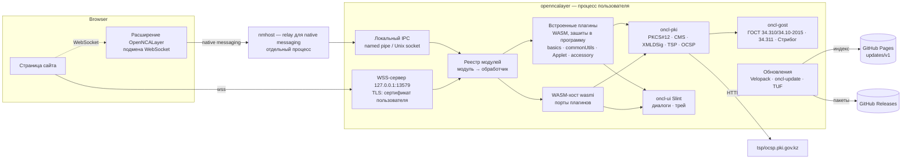
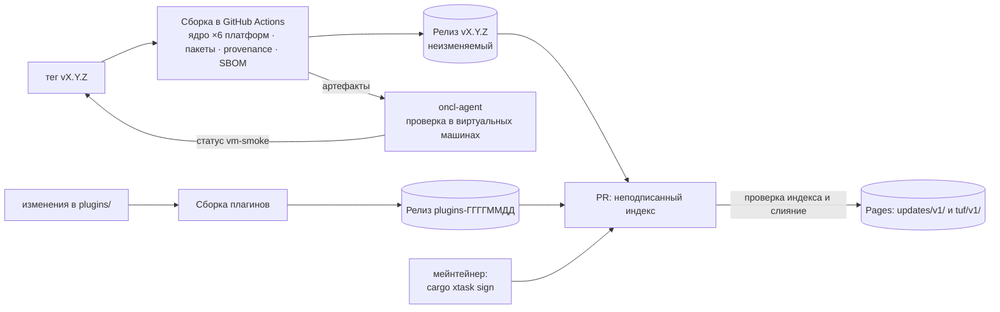

# OpenNCALayer: решения, устройство и что сделано

Документ для тех, кто хочет понять, почему проект устроен именно так, и посмотреть, что в нём уже готово. Сначала цель и принятые решения, потом устройство программы, затем список готового и ещё не сделанного. Как оригинальный NCALayer устроен внутри, описано в [`docs/original/architecture.md`](../original/architecture.md). Шире про SDK, CLI и HTTP-сервис — в [platform.md](platform.md).

Локальные заметки по реверс-инжинирингу оригинала не публикуются. В документы и код попадают только факты из них: идентификаторы, константы, форматы.

## 1. Цель

OpenNCALayer — открытая замена NCALayer на Rust. Сайты (egov.kz, госзакупки, банки, ЭДО), которые сегодня работают с оригиналом через `wss://127.0.0.1:13579`, должны работать без изменений:

- по тому же протоколу;
- с теми же модулями;
- с портами сторонних плагинов.

## 2. Принятые решения

### Название, язык, лицензия

- **Язык** — Rust, Java не используется.
- **Название** — OpenNCALayer. Программа называется `openncalayer` (`openncalayer.exe`, но никогда не `NCALayer.exe`), крейты начинаются с `oncl-`, репозиторий `arynyklas/OpenNCALayer`.
- **Лицензия** — Apache-2.0 на весь репозиторий. Slint используется по лицензии Royalty-free 2.0 с обязательным указанием `AboutSlint`.
- **Документы** пишутся по-русски. Код, идентификаторы и коммиты — по-английски.

### Как сайт соединяется с программой

- **WSS на `wss://127.0.0.1:13579`** с сертификатом пользователя. Простой `ws://` не делаем. Сертификат берётся одним из трёх способов:
  1. Мастер создаёт локальный центр сертификации (CA) с ограничением имён (127.0.0.1, ::1, localhost) и сертификат сервера на срок до 800 дней, после чего ключ CA удаляется. Для перевыпуска создаётся новый CA и ставится заново.
  2. Сертификат сервера выпускается от CA, который у пользователя уже установлен (mkcert или свой). Только с согласия пользователя программа читает ключ этого CA, выпускает сертификат и перевыпускает его до истечения. Сам ключ CA она не копирует.
  3. Готовый сертификат сервера с цепочкой.
- **Программа сама сертификаты не ставит.** Исключение — явная кнопка с подтверждением: «Установить мой CA» или «Скачать и установить корни НУЦ» (с проверкой зашитых SHA-256). Сертификаты кладутся в хранилище текущего пользователя: Windows `CurrentUser\Root`, macOS login keychain, Linux — базы NSS выбранных профилей. Рядом есть кнопка «Удалить». Установщик и автозапуск ничего не ставят.
- **Расширение браузера** — Chromium (MV3) и Firefox (MV2). Оно подменяет `WebSocket` к 127.0.0.1:13579–13679 и ходит через native messaging к хосту `io.github.arynyklas.openncalayer`. Если наш хост не установлен, расширение пропускает запрос оригиналу. Идентификатор расширения для Firefox — `openncalayer@arynyklas.github.io`. Пока Firefox-версия распространяется как «unlisted» на AMO, Chromium — в режиме разработчика. Chrome Web Store и Edge — позже.
- **Безопасность протокола — как в оригинале:** без запроса согласия по origin и без списка разрешённых сайтов. Origin передаётся модулям в `addInfo`.

### Плагины и порты

- **Плагины — WASM** (wasmi 2.x) с набором разрешений (capabilities): ключи, подпись, диалоги, HTTP только по списку адресов, файлы через диалоги.
- **Встроенные модули оригинала** (basics, commonUtils, Applet, accessory) — тоже WASM-плагины, зашитые в программу. Они обновляются только вместе с ней. Доставлять их через индекс обновлений пока не стали: тот, кто держит ключ роли `targets`, получил бы код с доверием ядра и без окна согласия. Для такого пути нужна отдельная роль подписи с порогом выше 1.
- **Порты 40 сторонних модулей мы пишем сами,** пока вендоры не начнут делать свои.
- **Порядок портов** — по охвату: встроенные модули, семейство ecc.kz, клоны commonUtils, семейство CommonInvoker, прочие средние, тяжёлые.
- **`installBundle`** сопоставляется с нашим портом. Если порт есть, показывается окно подтверждения и порт ставится. Если нет, ответ `BUNDLE_NOT_FOUND_OR_ALREADY_INSTALLED` и подсказка в трее со ссылкой на каталог портов.

### Обновления и релизы

- **Подписанный индекс + неизменяемые файлы.** Индекс (`updates/v1/{stable,beta}.json`) лежит на GitHub Pages: версии ядра по платформам (`win-x64`, `win-x86`, `win7-x64`, `win7-x86`, `osx`, `linux-x64`), плагины, расширение, процент раскатки, отозванные версии и монотонный номер `seq`. Файлы лежат в неизменяемых GitHub Releases: ядро — в релизе `vX.Y.Z`, плагины — пачками `plugins-ГГГГММДД[.N]`. Клиент GitHub API не вызывает.
- **Подпись индекса — TUF** ([`tuf.md`](tuf.md)). Четыре роли с разными ключами Ed25519. `root` — один офлайн-ключ владельца, срок 365 дней. `targets` и `snapshot` — офлайн-ключи владельца, срок 30 дней. `timestamp` — единственный онлайн-ключ, срок 7 дней, он подписывает раз в сутки при публикации Pages. Ключи `root`, `targets` и `snapshot` в CI никогда не попадают. **Потеря или утечка ключа `root` означает переустановку у всех:** запасного ключа нет.
- **Ядро обновляет Velopack:** установка, дельты zstd цепочкой с откатом на полный пакет, замена каталога `current`, перезапуск. Свой источник обновлений читает индекс и проверяет цепочку TUF, `seq` и sha256.
- **Плагины обновляются отдельно** и перезагружаются без перезапуска ядра.
- **Откат.** Если новая версия запустилась, но не прошла проверку здоровья (сервер, окно), она откатывается на предыдущую версию из индекса. Дополнительно от падения при старте защищают канал beta, постепенная раскатка, тест в виртуальных машинах и откат после двух упавших подряд запусков.
- **Каналы `stable` и `beta`.** Новое сначала выходит предварительными версиями и идёт только в beta (в том числе сборки для Windows 7 и новые порты). Релиз попадает и в stable, и в beta. Кому версия достанется раньше, решает бакет `sha256(install_id‖version)`. Сломанная версия отзывается правкой индекса: её перестают предлагать, а те, кто на ней, получают последнюю неотозванную. Понизить версию можно только с отозванной.
- **Версии.** Ядро — semver по тегу `vX.Y.Z`, расширение — та же версия. У плагина своя версия плюс указание, какой модуль оригинала и какой версии он заменяет. Журнал изменений собирается из conventional commits.
- **Подпись кода.** Аккаунтов пока нет. Шаги CI для Authenticode (SignPath), нотаризации Apple и публикации в Chrome Web Store и Edge заложены и включаются секретами. Независимо от этого каждый релиз несёт подтверждение происхождения сборки (build provenance) и SBOM.

### Установка и платформы

- **Установка на пользователя, без прав администратора, через Velopack.**
  - Windows: `Setup.exe`, отдельные установщики для Windows 10/11 и Windows 7. Установщик сам проверяет ОС. Данные ставятся в `%LOCALAPPDATA%\OpenNCALayer`.
  - macOS: универсальное приложение `.app` в `.pkg` и `.zip`, LaunchAgent.
  - Linux: AppImage с самообновлением, собирается в контейнере с glibc 2.28. К каждому релизу прикладывается пакет pacman `openncalayer-bin`: пользователь обновляет его вручную. Пакеты deb и rpm — позже вместе с репозиториями APT и RPM.
  - Данные пользователя лежат отдельно от установки и переживают удаление.
- **Платформы:** Linux (Debian, Ubuntu, Arch, Fedora; X11 и Wayland), macOS (x86_64 и arm64), Windows 10/11 x64/x86 и **Windows 7 SP1 x64/x86 — на равных правах.** Для Windows 7 делается отдельная сборка на закреплённой версии nightly, в CI есть проверка, что в ней нет вызовов Windows 8+, и тест в виртуальной машине с Windows 7.
- **Сосуществование с оригиналом.** При установке автозапуск оригинала отключается, но сам оригинал не удаляется. В настройках есть «Вернуть оригинал». Ярлыки автозапуска переносятся в папку данных, `ncalayer.desktop` получает `Hidden=true`. Запись об изменениях пишется до каждого шага, поэтому прерванное отключение или возврат можно довести повторным вызовом. Запись в системном реестре (HKLM Run) только показывается: без прав администратора её не отключить, окно даёт инструкцию. Остановка оригинала — только по пункту меню трея с подтверждением, и перед ней проверяется, что это тот же процесс.
- **Native messaging.** Манифест указывает на маленький relay `nmhost`, лежащий вне каталога, который заменяет Velopack. Relay только пересылает сообщения программе по локальному IPC и при необходимости запускает её. Сам relay заменяется переименованием без ожидания, запущенные экземпляры дорабатывают со старым файлом.

### UI, хранилища ключей, проверки

- **Интерфейс — Slint,** программный рендерер. Трей — `tray-icon` и `muda` (на Linux `ksni`). Выбор файлов — `rfd`.
- **Ключи.** Файлы PKCS#12 поддерживаются с самого начала. Токены (Kaztoken, удостоверение личности, eToken, JaCarta, AKey) делались последними: экспериментально, выключены по умолчанию, только чтение и подпись. Проверены на эмуляторе, на реальном железе нет. Записи на токены нет.
- **Эталоны.** Оригинальный NCALayer запускается только в изолированных виртуальных машинах лаборатории. Снятые записи остаются локально и не публикуются. В репозитории лежат только наши тестовые данные: синтетический PKI и публичные сертификаты НУЦ.
- **Лаборатория.** Изолированные виртуальные машины: Linux, Windows 7 x86 и x64, Windows 11, и всегда включённая машина агента `oncl-agent`. Сеть лаборатории закрыта от локальной сети, выход только в интернет. Тестовые машины по умолчанию выключены и перед каждым прогоном откатываются к снимку. Инфраструктура приватная.
- **Проверка перед релизом.** Агент `oncl-agent` сам забирает артефакты сборки тега (токеном только на чтение), откатывает тестовые машины, прогоняет проверки на Windows 7, Windows 11 и Linux и ставит на коммит тега статус `vm-smoke`. Self-hosted runner не используется. Сценарий проверки ведёт мейнтейнер.
- **Каталог плагинов** — сайт на Zola (ru/kk/en) на GitHub Pages. Данные берутся из файла `registry.toml` каждого порта, сайт собирает `cargo xtask registry`.
- **Наблюдатель за оригиналом.** Один наблюдатель следит за ядром и плагинами оригинала (их публикует один манифест `ncalayer.der`). Работает как `cargo xtask upstream`, запускается workflow `upstream.yml` каждые 6 часов и вручную, только с `GITHUB_TOKEN`. Оригиналы скачиваются во временную папку и не запускаются. Публично остаются только факты: версия, размеры, sha256, бандлы, сертификаты, имена модулей и методов, коды ошибок. Они лежат в ветке `upstream` (только JSON) и в issues.

## 3. Устройство программы

### Крейты

| Крейт | Что делает |
|---|---|
| `oncl-gost` | ГОСТ-кривые и подпись ГОСТ 34.10 в казахстанской кодировке, хеши ГОСТ 34.311 и «Стрибог». |
| `oncl-pki` | Разбор BER/DER, PKCS#12 и PKCS#8, сертификаты и казахстанские атрибуты, CMS (подпись, со-подпись, проверка), метки времени, OCSP, проверка цепочки, XMLDSig. |
| `oncl-protocol` | Протокол NCALayer: приветствие, heartbeat, маршрутизация, `MODULE_NOT_FOUND`, форматы ответов, семантика `CommonInvoker`. |
| `oncl-flows` | Окна, которые ядро показывает модулям и плагинам, выбор ключа, правила путей и PIN для страниц. |
| `oncl-builtin-basics`, `-commonutils`, `-applet`, `-accessory` | Встроенные модули оригинала в виде WASM. Ключи, окна, файлы, токены и сеть остаются в ядре. |
| `oncl-builtins-build` | Сборка встроенных модулей, их вшивание в программу и сверка контрольных сумм. |
| `oncl-builtin-tests` | Тесты встроенных модулей (не публикуется). |
| `oncl-plugin` | Плагины: пакет `.onclp`, манифест `plugin.toml`, рантайм wasmi, пул встроенных модулей ([`plugins.md`](plugins.md)). |
| `oncl-tls` | Мастер локального CA и сертификата, импорт своего сертификата, инструкции. |
| `oncl-token` | Токены и удостоверение личности по PC/SC (экспериментально): [`tokens.md`](tokens.md). |
| `oncl-ui` | Диалоги на Slint, трей и настройки. |
| `oncl-update` | Формат индекса, проверка метаданных TUF и `seq`, раскатка и отзыв, источник обновлений для Velopack, обновление плагинов. |
| `openncalayer` | Сама программа: командная строка, WSS и HTTP-сервер, пути, настройки, логи. |
| `xtask` | Вспомогательные команды: тестовые данные, проверка импортов Windows 7, индекс и подпись, сайт, лаборатория. |

Крейты SDK, CLI и сервиса (`oncl-core`, `oncl-api`, `oncl-cli`, `oncl-server` и др.) описаны в [platform.md](platform.md).

### Как устроены плагины

Плагин — архив из двух файлов:
- `plugin.wasm`;
- `plugin.toml`: идентификатор, версия, имена модулей, какой модуль оригинала и какой версии он заменяет, разрешения и минимальная версия ядра.

Целостность плагина обеспечивает sha256 в индексе, а подлинность индекса проверяет TUF. Подписи вендоров появятся вместе с делегированием TUF.

Плагин и программа общаются через CBOR в линейной памяти WASM (без WASI). Программа регистрирует имена модулей плагина в общем реестре (первый зарегистрировавший побеждает, как в оригинале) и вызывает `process(request, addInfo)`. Набор `oncl-pdk` на Rust скрывает эти детали. Порт оригинального модуля отвечает байт в байт тем же JSON, что и оригинал.

Встроенные модули оригинала — такие же плагины, зашитые в программу. Им доверяют как ядру: они ставятся без окна согласия, их нельзя удалить или выключить, и им доступны данные, которые ядро держит за модуль. Ключи, пароли и согласия после каждого вызова сбрасываются. Сбой встроенного модуля обрывает соединение, как раньше падал нативный модуль. Подробности — в [`plugins.md`](plugins.md).

### Как идут релизы и обновления

Что делает установленная программа:
1. Через 2–10 минут после запуска, а потом раз в 6–24 часа (время случайное) скачивает индекс своего канала.
2. Проверяет цепочку TUF и сам индекс. Индекс с `seq` меньше последнего принятого отвергается.
3. Для ядра строит список версий для своей платформы с учётом раскатки и отзыва и отдаёт его Velopack. Velopack скачивает дельты или полный пакет (sha256 проверяется), ставит и перезапускает программу, когда нет активных запросов и окон.
4. Для плагинов скачивает изменившиеся `.wasm`, сверяет sha256 и перезагружает модуль без перезапуска.
5. После обновления проверяет, что всё работает (сервер, окна). При провале откатывается.

## 4. Что сделано

Работы шли по этапам. Здесь они описаны простыми словами.

**Готово:**

- **Базовый срез.** ГОСТ, PKCS#12, подпись CMS с метками времени, протокол NCALayer, подпись в `basics`, мастер TLS, WSS, диалоги, демо-страница с `ncalayer-js-client`.
- **Расширение браузера и native messaging.** Подмена WebSocket для Chromium и Firefox, relay `nmhost` вне каталога обновлений, переподключение при перезапуске программы, нарезка больших ответов, сквозной проход к оригиналу, регистрация хостов.
- **Проверка сертификатов.** Встроенные корни НУЦ, проверка цепочки по RFC 5280 (без политик и ограничений имён), OCSP, CRL для промежуточных центров, окно с причинами и датой отзыва.
- **Весь протокол NCALayer.** XMLDSig в форме Kalkan, `basics` (xml, генерация CSR, импорт сертификата), commonUtils, подмножество Applet для файловых хранилищ, accessory.
- **Рабочий стол.** Трей, настройки (язык, автозапуск, прокси для TSP/OCSP/CRL), блоки «Оригинальный NCALayer» и «Расширение браузера», мастер TLS с собственным CA, mkcert и импортом.
- **Windows 7.** Сборки x64 и x86 на закреплённой версии nightly, проверка импортов в CI на каждый push, тест в виртуальной машине.
- **Обновления и установщики.** Индекс, проверка подписи, раскатка и отзыв, Velopack, проверка здоровья после обновления и откат. Установщики для Windows (четыре платформы), macOS и Linux, а также пакет pacman.
- **Лаборатория и агент** `oncl-agent`: прогон установщиков в виртуальных машинах и статусы на коммите тега.
- **Сверка с оригиналом.** Одни и те же запросы отправляются оригинальному NCALayer 1.4 и нашей программе на Windows 11 и Linux. Проверены протокол, сервер, встроенные модули и 32 порта из 35. Каждое найденное расхождение исправлено и закреплено тестом, либо записано как отличие, либо признано ненаблюдаемым. В канал `stable` идут только порты, подтверждённые сверкой.
- **Плагины.** Формат `.onclp`, манифест с разрешениями, рантайм wasmi, окна и файлы только через диалоги, HTTPS по заданным адресам, SDK `oncl-pdk`, плагины в индексе обновлений.
- **Каталог портов.** Сайт на Zola на трёх языках, страница каждого порта, колонка «оригинал изменился после порта», «История оригинала».
- **35 портов** в `plugins/`: 34 по группам из плана (ecc.kz — 4, клоны commonUtils — 7, CommonInvoker — 5, прочие средние — 12, тяжёлые — 6) и `onaidocs`. У каждого есть `plugin.toml` и `registry.toml` с отличиями от оригинала. Сверкой подтверждены 32 порта; у `simourg`, `ezsigner` и `onaidocs` ожидания посчитаны, а не сняты с оригинала.
- **Токены.** Драйверы Kaztoken, удостоверения личности, eToken PRO 72K, eToken 5110, JaCarta и AKey (чтение ключей, сертификатов и подпись), свой интерфейс к PC/SC без зависимости в бинарнике, эмулятор. Экспериментально, по умолчанию выключено ([`tokens.md`](tokens.md)).
- **Встроенные модули как WASM.** basics, commonUtils, Applet и accessory работают как WASM-плагины внутри программы. Ответы и окна прежние, тесты модулей перенесены без правки ожиданий.
- **Наблюдатель за оригиналом.** Проверка подписи манифеста по корням НУЦ, опрос источников, скачивание с лимитами и только с публичных адресов, распаковка без запуска, сравнение версий, issues, ветка `upstream`.
- **Основа TUF.** Подпись индекса обновлений через TUF вместо прежнего minisign.

**Не сделано или в работе:**

- Делегирование подписи вендорам плагинов в TUF (понадобится с первым внешним вендором).
- Доставка встроенных модулей через индекс обновлений.
- Переработка выпусков: убрать срок действия предварительных версий.
- Подписи установщиков кодом (нет аккаунтов), публикация расширений в магазинах Chrome и Edge, пакеты deb и rpm.
- Шифрование и расшифрование, аппаратные токены на реальном железе.
- SDK, CLI и HTTP-сервис, публикация SDK в crates.io и WinGet: см. [platform.md](platform.md).

## 5. Внешние аккаунты (на будущее)

- Chrome Web Store ($5) и проект Google Cloud для публикации из CI.
- Edge Partner Center.
- Mozilla AMO (уже нужен для подписи «unlisted»).
- SignPath Foundation.
- Apple Developer.
- Регистрация в SDK НУЦ: нужен мейнтейнер с ЭЦП. Запрос в knca@pki.gov.kz о праве распространять тестовые ключи.
- Аппаратные ключи YubiKey (3–5 штук) для TUF.

## 6. Главные риски

| Риск | Что делаем |
|---|---|
| Windows 7 ломается от свежих крейтов (`combase.dll`, вызовы Windows 8+) | Отдельная сборка, проверка импортов в CI, тест в виртуальной машине. |
| Казахстанские особенности: порядок байт в ГОСТ, BER-CMS от Kalkan, PBES2 с PRF по умолчанию SHA-256 | Тесты на реальных сертификатах НУЦ и данных NCANode, сверка с оригиналом. |
| Без установленного CA протокол wss не работает | Мастер TLS и расширение браузера. |
| Сайты меняют поведение оригинала (например, новые модули) | Наблюдатель за оригиналом и регулярная сверка с ним. |
| НУЦ блокирует доступ к своим сайтам с адресов GitHub | Первый ручной запуск `upstream.yml` это покажет (issue `upstream-alert`). Тогда факты собирает приватная лаборатория, а мейнтейнер приносит их PR'ом в ветку `upstream`. См. [`docs/dev/upstream-watch.md`](../dev/upstream-watch.md). |
| Velopack — внешняя зависимость: тянет `windows` 0.62 (на Windows 7 нужен форвардер ole32) и `ureq` 3 с TLS по умолчанию, `vpk` требует .NET в CI | Форвардер и проверка импортов закрывают и Velopack. TLS — rustls на ring: `deny.toml` запрещает `openssl`, `openssl-sys` и `native-tls`, а `aws-lc-*` разрешён только на Unix. `vpk` нужен только в CI. |
| Velopack при обновлении и удалении заменяет `current` и завершает все процессы под корнем установки, включая relay: NM-хост умер бы посреди подписи | Обновление ставится только в простое (нет запросов и окон). Расширение переподключается к relay на следующем сокете. Relay лежит вне `current`, поэтому путь в манифестах переживает обновление. |
| Старый подписанный индекс можно подсунуть, пока он действителен: при взломе Pages можно ненадолго «заморозить» обновления | Подделать подпись без ключей владельца нельзя. Подмену старым снимком ограничивают срок `timestamp` (7 дней, подписывается ежедневно), срок `snapshot` (30 дней) и `seq`, который не идёт назад. Заморозку не закрыть полностью, если украден онлайн-ключ `timestamp`: он позволяет перевыпускать старый снимок до конца срока `snapshot`, но не новое содержимое ([`tuf.md`](tuf.md)). |
